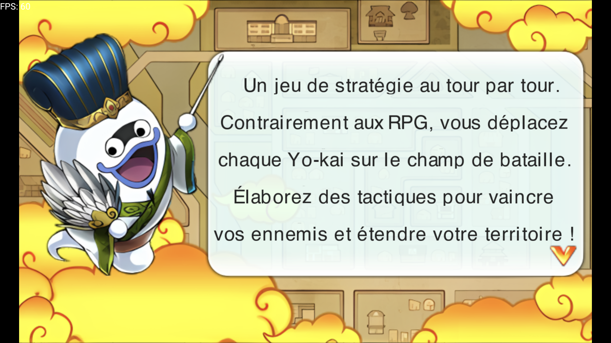
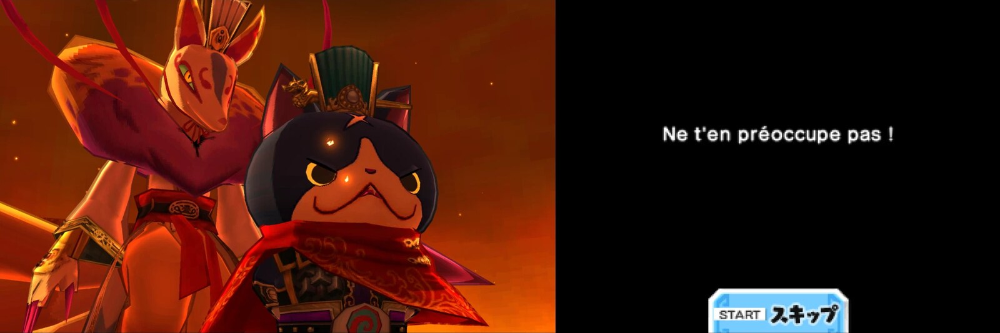
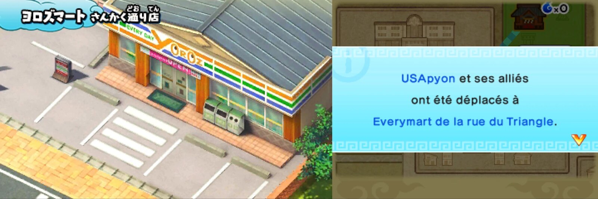
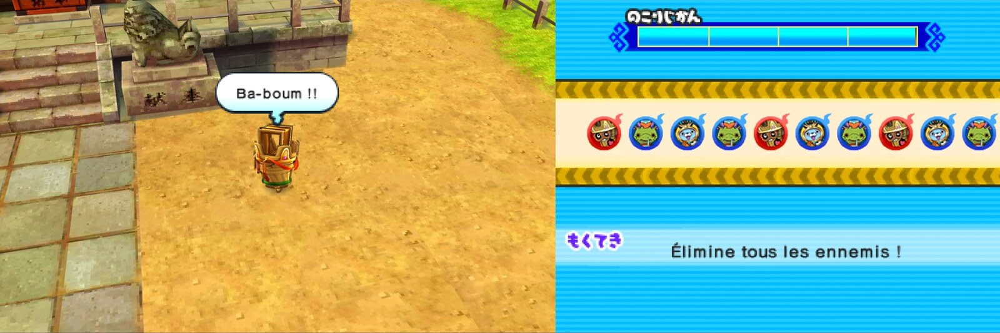
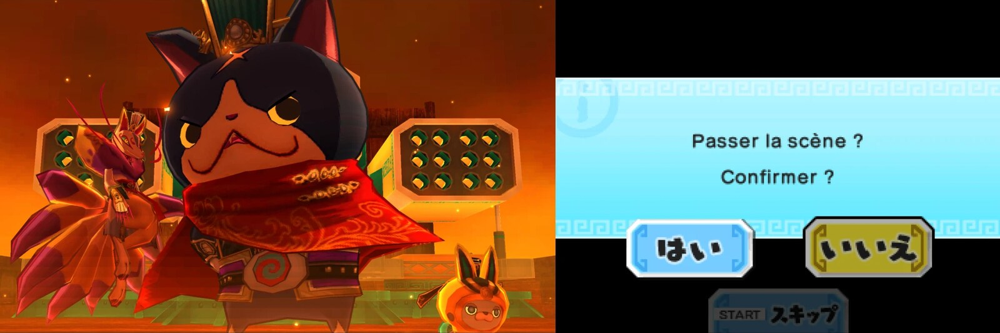

# Romance des Trois Royaumes — Yo-kai Watch Sangokushi en français (et en anglais)

*English version: see [Quelle version ?](#quelle-version-) below — a machine-translated (DeepL) English patch with the official Yo-kai names is available.*

**Le jeu de stratégie Yo-kai Watch inspiré des Trois Royaumes, enfin jouable en français.**

*Yo-kai Watch Sangokushi* (3DS, LEVEL-5) n'est jamais sorti hors du Japon. Ici, on retrouve USApyon en stratège, des Yo-kai en armure, des batailles au tour par tour pour étendre son territoire… et tout est maintenant lisible : dialogues, bulles, menus, tutoriels, bannières, sous-titres de cinématiques.

## Ce que vous obtenez

- **Les 1 308 scripts du jeu traduits** : histoire, dialogues, tutoriels, objectifs, messages système.
- **Une police française complète** : accents, `« »`, `œ`, apostrophes… avec chasse variable, donc un texte propre et pas de lettres espacées comme dans une police japonaise.
- **Un moteur de texte adapté** : retours à la ligne automatiques, équilibrage des lignes, fenêtres et bulles ajustées à la longueur du français.
- **Ça ressemble à un vrai jeu français** : les captures ci-dessous sont des captures réelles du jeu patché.

## Avertissements — à lire avant de jouer

### Les textures ne sont pas traduites
Seul le **texte** est en français. Les images du jeu (titres de lieux (le nom du magasin ci-dessus par exemple), boutons « SKIP » / « はい / いいえ », en-têtes « 残り時間 » ou « 目的 », enseignes, noms au-dessus des personnages…) restent en japonais. Les traduire demande de redessiner des textures, et je n'ai pas les compétences artistiques pour le faire. Si vous savez dessiner et que ça vous tente, les contributions sont les bienvenues !

### Le jeu peut planter à tout moment
Ce patch modifie le code de l'exécutable (moteur de texte en ARM natif, placé dans du code que j'ai jugé inutilisé). Je n'ai eu **aucun plantage** pendant mes tests, mais je ne peux pas garantir que toutes les parties du jeu ont été couvertes.

- **Sauvegardez très souvent**, et gardez plusieurs fichiers de sauvegarde (ou des états de sauvegarde d'émulateur).
- **Si le jeu plante**, c'est peut-être parce que le patch a supprimé une fonction qui était en réalité utilisée. **Prévenez-moi** en ouvrant une [issue](https://github.com/JulienGery/romance-des-Trois-Royaumes/issues) avec : l'endroit du jeu, ce que vous faisiez juste avant, l'émulateur utilisé et si possible le log. Je pourrai corriger le patch.

## Quelle version ?

| Version | Fichier à télécharger | SHA-256 du résultat |
|---|---|---|
| **Français** (traduction relue) | `YokaiWatchSangokushi-FR.xdelta` | `4a365b26600df577214bb0a950a573e4459731050f982c7fbcb9efd34d6dbbd6` |
| **English** (traduction automatique DeepL depuis le japonais, noms officiels des Yo-kai, **à relire**) | `YokaiWatchSangokushi-EN.xdelta` | `a5e8f654204149d2d357349bc5040a8fd1296099daeee75bb5b9e0d019f3f6f3` |

La version anglaise est un **brouillon** : traduite automatiquement du japonais (DeepL), avec les noms anglais officiels des Yo-kai du *Yo-kai Watch Wiki* (CC BY-SA) quand ils existent ; les Yo-kai propres à *Sangokushi* n'ont pas de nom officiel et gardent la traduction automatique. Les mêmes avertissements s'appliquent. Les corrections sont les bienvenues (voir plus bas).

## Installation (avec le patch xdelta)

Aucun outil à installer : tout se fait dans le navigateur.

**Il vous faut :**
- votre **propre dump déchiffré** de la version japonaise du jeu (titre `000400000018B000`), au format `.cci`. Le patch ne fonctionne que sur ce dump exact, dont le SHA-256 est :
  `8776733296fb2f984e86102c834693b952aeae62789b4a584320c4fec359a453`
- le fichier **`YokaiWatchSangokushi-FR.xdelta`** ou **`YokaiWatchSangokushi-EN.xdelta`** (≈ 4 Mo), à télécharger dans la section [**Releases**](https://github.com/JulienGery/romance-des-Trois-Royaumes/releases).

**Étapes :**
1. Ouvrez **<https://kotcrab.github.io/xdelta-wasm/>** (xdelta dans le navigateur, rien n'est envoyé sur Internet : les fichiers restent sur votre machine).
2. **Source file** : choisissez votre dump japonais `.cci`.
3. **Patch file** : choisissez le fichier `.xdelta` de la version voulue (FR ou EN).
4. Lancez l'application du patch et téléchargez le fichier obtenu (≈ 860 Mo : prévoyez un peu de patience et de mémoire vive).
5. *(Optionnel)* vérifiez que le SHA-256 du résultat est celui du tableau ci-dessus.
6. Lancez le `.cci` obtenu dans votre émulateur.

Si le patch est refusé, c'est que votre dump n'est pas identique à celui attendu (vérifiez son SHA-256, il doit aussi être déchiffré).

### Où jouer ?
- ✅ **Émulateur** : testé avec **Zakuro** (avec ce `.cci`) et **Azahar** (avec le `.cxi` équivalent).
- ❓ **Console réelle** : non testé. Le fichier n'est pas signé et l'exheader est modifié ; il faudrait le convertir en CIA et utiliser des patchs de signature.

## Contribuer / signaler un problème

- Un texte mal traduit, une fenêtre qui déborde, un mot coupé bizarrement : ouvrez une [issue](https://github.com/JulienGery/romance-des-Trois-Royaumes/issues) avec une capture.
- Un plantage : voir plus haut, c'est le cas le plus utile à me signaler.

## Pour les développeurs

Compiler le patch soi-même, détails du moteur ARM, de la police, **traduire vers une autre langue** (DeepL, noms officiels, pipeline `fr_patch/build_language.sh`) et outils : [docs/TECHNIQUE.md](docs/TECHNIQUE.md). Spécifications et état du projet : [`rapport/HANDOVER.md`](rapport/HANDOVER.md) et [`rapport/JOURNAL_MODIFICATIONS.md`](rapport/JOURNAL_MODIFICATIONS.md).

## Mentions

Projet de fan non officiel, sans but lucratif. *Yo-kai Watch* est une marque de LEVEL-5. Les noms anglais officiels des Yo-kai proviennent du [Yo-kai Watch Wiki](https://yokaiwatch.fandom.com) (CC BY-SA). Ce dépôt ne contient aucune ROM ni donnée du jeu, à une exception près : l'atlas de police pré-construit (`fr_patch/atlas/`) contient des glyphes dérivés des polices de Yo-kai Watch 2 (LEVEL-5), à retirer si le détenteur des droits le demande. `polices/Level5FontAtlas` est dérivé de [Kuriimu2](https://github.com/FanTranslatorsInternational/Kuriimu2) et reste sous **GPL-3.0**. Aucune licence n'a encore été choisie pour le reste du code.
